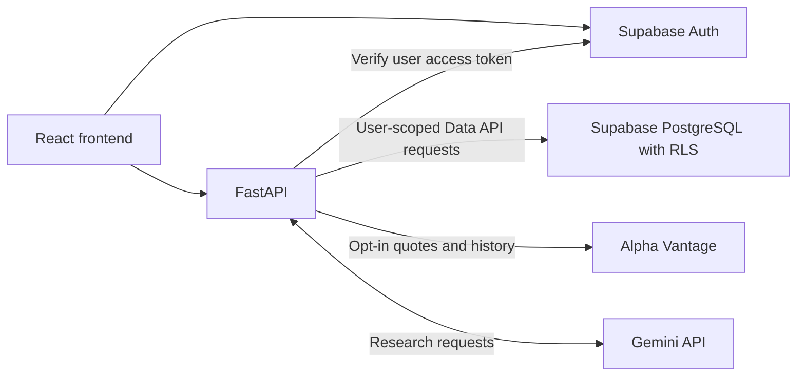

# MarketSim

[](https://github.com/Irvin02051/MarketSim/actions/workflows/ci.yml?query=branch%3Amain)

MarketSim is an AI-assisted stock research application for exploring **AAPL, MSFT,
and NVDA** through charts, backend-calculated metrics, and evidence-linked findings.
Users can sign in and maintain persistent personal watchlists. Fictional demo data
works without market-data credentials; optional real end-of-day data is intended
for private local development.

## What works today

- **Accounts:** Supabase signup, email confirmation, login, session restoration,
  local sign-out, a protected Account page, and explicit backend identity verification.
- **Personal watchlists:** authenticated add/list/remove, duplicate handling, and
  PostgreSQL ownership policies. The dashboard's sample watchlist remains separate.
- **Quotes and charts:** labeled fictional quotes and 2024–2025 synthetic weekday
  history, interactive closing-price charts, and optional Alpha Vantage end-of-day data.
- **Descriptive statistics:** price change, 20/50-observation moving averages, and
  adjacent-return variability, with actual windows and explicit insufficient-data states.
- **Research:** a bounded tool-calling agent and a separate opt-in real-data planning
  workflow, both with validated evidence, limitations, and safe partial/error states.
- **Confirmed saving:** on `/research`, signed-in users can review and explicitly
  confirm saving a supported symbol from validated quote or historical evidence.
  This is a user action, not a model write tool, and is not offered on `/research/real`.

## Architecture

React 19, TypeScript, Vite, React Router and Recharts form the frontend; FastAPI,
HTTPX and typed validation form the backend. Supabase supplies Auth and PostgreSQL.



**Existing research (`/research`):** the agent selects validated `get_quotes` and
`get_historical_metrics` calls within bounded execution limits. Tool evidence is
returned to Gemini; backend code validates findings and owns calculations. Historical
evidence is fictional. Quotes follow the configured quote mode, so this path is
not a blanket guarantee that real provider evidence never reaches Gemini. Use demo
quote mode for the fictional research walkthrough.

**Real research (`/research/real`):** one Gemini call produces a validated plan
before retrieval. Backend code then retrieves real history, calculates raw metrics,
and renders findings. Provider observations and calculated values are not returned
to Gemini in this workflow. Questions still go to Gemini; do not include secrets,
personal information, or provider datasets.

Frontend route guards are UI controls. FastAPI independently verifies access tokens
for identity/watchlist requests, and database Row Level Security enforces ownership.
Market-data and Gemini keys stay backend-only; React never needs an administrative
Supabase key.

## Data modes and limits

| Mode | Meaning |
| --- | --- |
| Fictional demo | Default quotes and fixed synthetic history; not actual prices or an exchange calendar. Standalone quotes and historical fixtures are separate datasets. |
| Private-local provider | Explicitly enabled Alpha Vantage end-of-day quotes and raw, unadjusted daily history; not real-time data. |

Real history uses a moving compact snapshot and requests of at most 90 calendar
dates. A requested range outside available bounds fails explicitly rather than
being silently truncated or replaced with demo data. Missing observations are not
filled, and missing volume remains null. Coverage does not prove exchange-calendar
completeness; retrieval time is not market freshness.

Raw price change is **not total return**. Splits and dividends are neither adjusted
nor checked. Raw-return variability is not a reliable investment-risk measure.
Statistics describe supplied observations, not forecasts or investment recommendations.

Provider quotes/history share a process-local budget of 20 attempts per rolling
24 hours, including failed attempts. Six-hour caches and request coalescing reduce
repeat calls and preserve original fetch timestamps. Use one local backend worker:
multiple workers or restarts do not share budget accounting. Provider quotas still
apply; there is no automatic retry or fictional fallback after provider failure.

Feature flags are **not authentication** or permission to expose data publicly.
Keep provider features disabled in public demos until display/data-use rights are
resolved. Free API access does not establish redistribution or external-model rights;
the planning-only workflow does not resolve public-display permission.

## Key-free demo quick start

Use Python **3.13** (the CI runtime) and Node **22.12+ within Node 22** with npm.
Run from a fresh checkout with no local environment files or exported application
credentials. These commands install dependencies; they do not configure external
services. Existing configured checkouts should use the isolated setup guidance in
[frontend documentation](frontend/README.md), rather than overwrite local settings.

Terminal 1, from the repository root:

```sh
cd backend
python3.13 -m venv .venv
.venv/bin/python -m pip install -r requirements-dev.txt
MARKET_DATA_PROVIDER=demo RESEARCH_ENABLED=false \
REAL_HISTORY_ENABLED=false REAL_RESEARCH_ENABLED=false \
ALPHA_VANTAGE_API_KEY= GEMINI_API_KEY= SUPABASE_URL= SUPABASE_PUBLISHABLE_KEY= \
.venv/bin/python -m uvicorn app.main:app --host 127.0.0.1 --port 8000 --workers 1
```

Terminal 2, from the repository root:

```sh
cd frontend
npm ci
VITE_API_BASE_URL=http://127.0.0.1:8000 \
VITE_REAL_HISTORY_ENABLED=false VITE_REAL_RESEARCH_ENABLED=false \
VITE_SUPABASE_URL= VITE_SUPABASE_PUBLISHABLE_KEY= VITE_AUTH_CALLBACK_URL= \
npm run dev -- --host 127.0.0.1 --port 5173 --strictPort
```

Open `http://127.0.0.1:5173/dashboard` for public demo access, or
`http://127.0.0.1:5173/stocks/AAPL` for fictional history. Choose dates within
2024–2025. Accounts, persistent watchlists and Gemini research require separate
configuration; the key-free setup intentionally leaves them unavailable.

- [Backend setup, endpoints, configuration and provider limitations](backend/README.md)
- [Frontend setup, auth callbacks, feature flags and manual checks](frontend/README.md)
- [Watchlist schema, local PostgreSQL tests and migration safety](supabase/README.md)

Do not automatically apply hosted migrations. Watchlist setup requires a separately
reviewed schema deployment and matching Supabase configuration.

## Testing and CI

[CI workflow](.github/workflows/ci.yml) runs separate backend and frontend jobs on
pull requests and pushes to `main`, with read-only permissions, pinned official
actions, dependency-download caches, timeouts and cancellation of obsolete PR runs.
It has no deployments or secrets and needs no live services or Docker.

- Backend: requirements installation, `python -m ruff check app tests`,
  `python -m unittest discover -s tests -v`, and `python -m pip check` from `backend/`.
  Use the workflow's demo/disabled-service environment settings for local checks.
- Frontend: `npm ci`, `npm test`, `npm run lint`, and production build from `frontend/`.
  Use the workflow's temporary `envDir: false` configuration and clean environment
  for an isolated build; ordinary Vite commands can load local environment files.
  The existing non-failing bundle-size warning remains visible.

Mocked tests verify contracts and failure handling, not live provider availability
or financial accuracy. Frontend tests include helpers/controllers and static
rendering, not full mounted-browser automation. Manual browser checks do not replace
browser automation. The separate PostgreSQL/pgTAP isolation suite is not run by
these CI jobs and does not prove hosted configuration or JWT verification.

The maintainer reported both hosted jobs passing after the timezone-data fix.
Consult the linked workflow for current run status. Branch protection is a separate
GitHub setting; a local pass alone does not establish a hosted pass.

## A 3–5 minute walkthrough

1. **No keys:** open `/dashboard`, then an AAPL history chart. Select a short
   2024–2025 range, inspect a tooltip and expanded table, and note fictional labels.
2. **Gemini configured:** with demo quotes and research enabled, visit `/research`
   and request a supported comparison. Submission consumes external Gemini requests;
   inspect tool activity, evidence and limitations. History remains fictional.
3. **Supabase configured with reviewed schema:** sign in, open `/watchlist`, add a
   symbol, reload, and remove it. These actions contact Supabase through the app.
   On `/research`, review and confirm an evidence-backed save; Cancel writes nothing.
4. **Optional private-local configuration:** enable real history/research as described
   in the detailed READMEs and visit `/research/real`. Submit one explicit date-range
   question within the current compact snapshot. This consumes a Gemini planning
   call and provider attempts on cache misses. Inspect backend findings, provenance,
   cache status and unadjusted-price limitations; stop on quota errors.

## Status and future work

Research, charts, identity verification and personal watchlists are implemented.
Paper trading, portfolio accounting, forecasting, broader stock coverage and public
deployment are **not completed features**. Future work requires separate scope and
validation, including data rights and appropriate safeguards.

MarketSim is an educational application. Its fictional examples and raw descriptive
statistics are not financial advice or guarantees of market-data accuracy.
